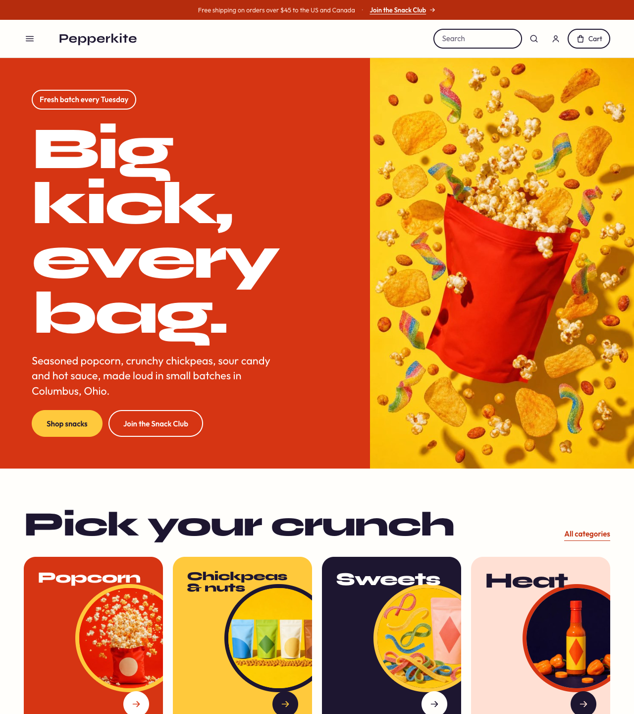

# Spinnaker

Spinnaker is a free storefront theme for **Wave**, the Swell storefront app with a visual editor and an AI agent. It is bold, warm and playful: very large headlines in a wide, heavy display face, sections on flat blocks of vermilion, sunshine yellow, deep ink and blush, and outlined cards with solid offset shadows. It fits any kind of store.

- Listing copy (the Swell Theme Store page): [`DESCRIPTION.md`](DESCRIPTION.md)
- The installable theme app: [`app/`](app)

## Using it

1. Install Spinnaker from the Swell Theme Store. It is free.
2. Customize it in the Wave editor: click any section or line of text to change it, set fonts, colors, spacing and Spinnaker's own settings in the Theme tab, or ask the AI agent for a change in plain words.
3. Publish when it's ready. Until then every change stays a draft.

Spinnaker reads the store's own Swell data (products, categories, menus, the blog and store details), so set those up in the Swell dashboard first. Shoppers check out on Swell's hosted checkout.

## What's inside

Spinnaker is the bold one of Swell's free themes; it changes the look, not the store's structure. Its own sections:

- `color_hero`: the home page opening: words on one block of color, a photo (or a drawn pattern) on another
- `category_tiles`: categories as big color tiles with photo circles
- `product_band`: products as a grid or rail on a band of color; on collection and search pages, the count, sort, folded filters and pages
- `statement_block`: two lines of brand voice in two colors, with an optional sticker
- `color_split`: a photo beside a block of words and a button
- `feature_blocks`: up to four points on colored blocks with big numbers
- `collection_masthead`: a category's name huge on a band of color
- `product_stage`: the product page: photos on a color tile, the buy box on its own block

Its own templates are home, product, collection and cart; its own Footer group sits on deep ink. Its theme settings (`theme/config/settings_content.json`) cover: a sticky header; cards' quick add, second photo on hover and number of color dots; the quantity box. Its colors, fonts and style choices are in `theme/config/settings.json`.

## How it's built

Spinnaker is built on Swell's shared theme core, like every Wave theme. The core provides the sections every theme has (header, footer, cart, account, search, blog, policies and the rest) and Store text, and every theme must show a Header and a Footer group on every page; Spinnaker adds its own sections, templates, settings and design over it. `app/` is the assembled theme, built from the core and the files here; change Spinnaker's own files and rebuild it, never edit `app/` by hand.

How a section is written, the repository layout and how a theme is assembled are the same for every theme on the core: see the README of Tide, Swell's first free theme.

## License

Spinnaker is licensed under the Swell Theme License (`LICENSE`), which covers this repository, the shared theme core in `app/` included.
